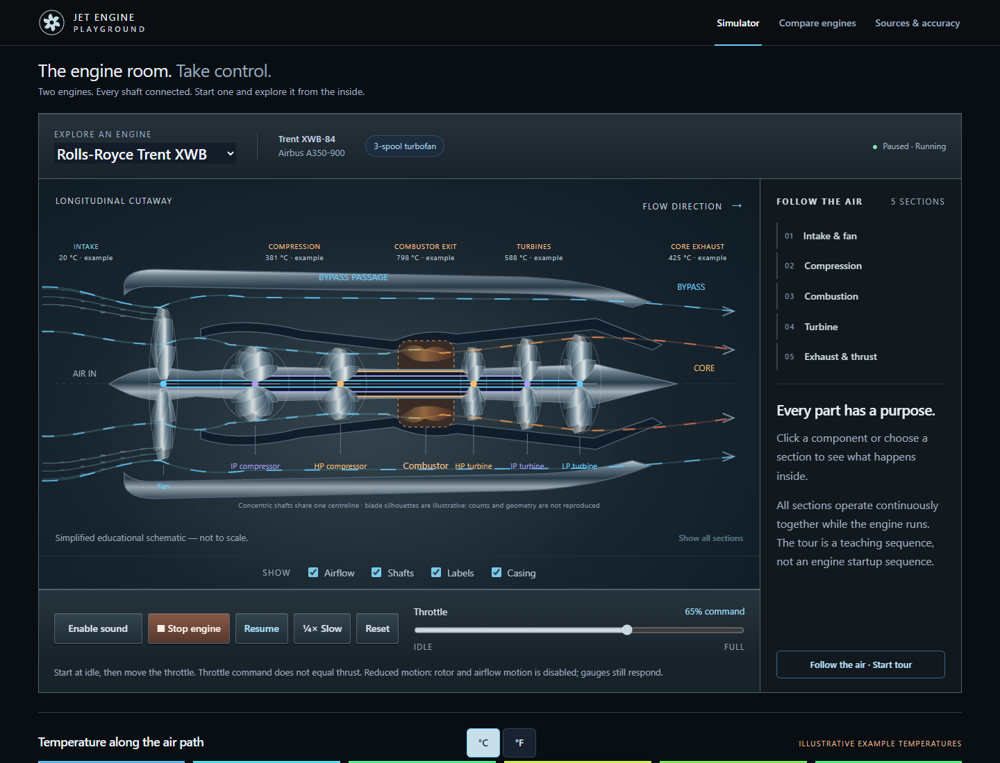
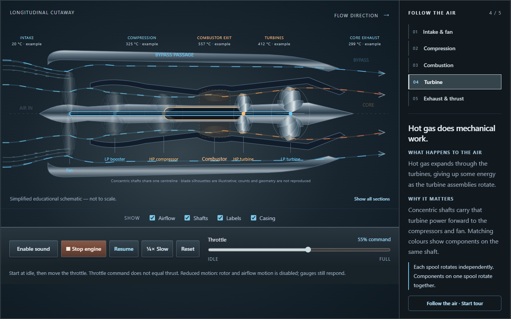
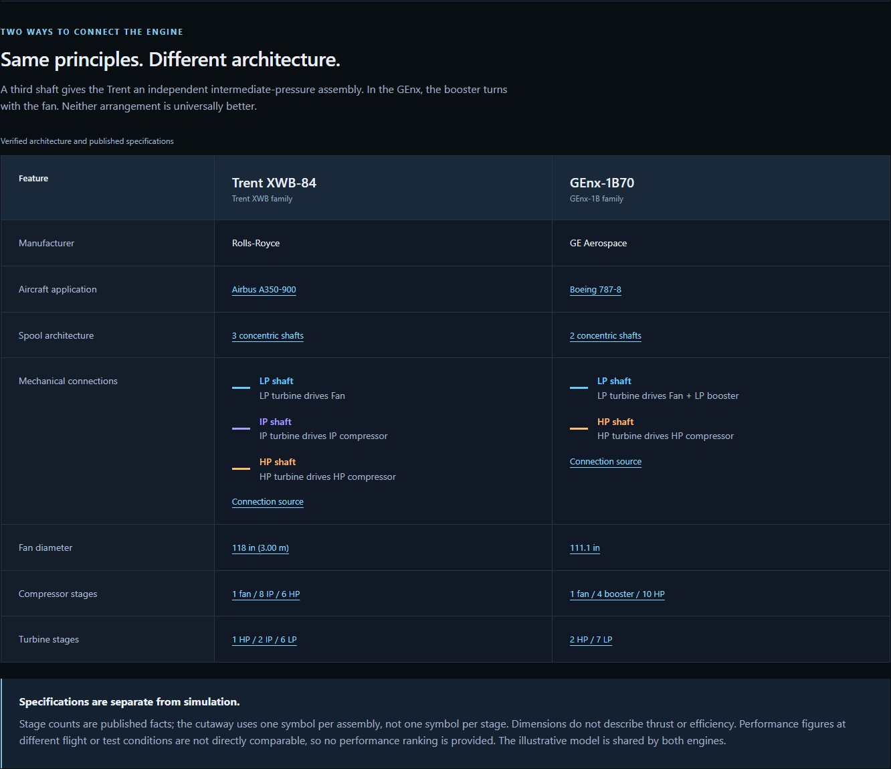
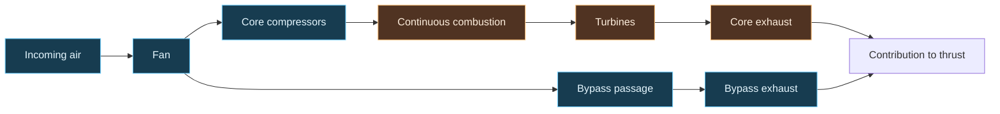
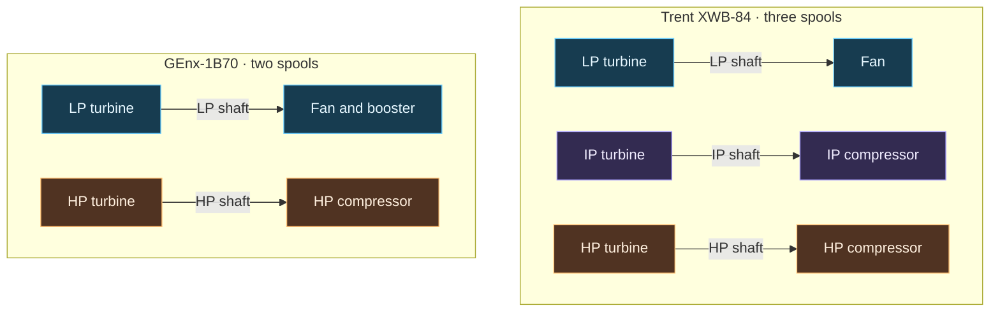
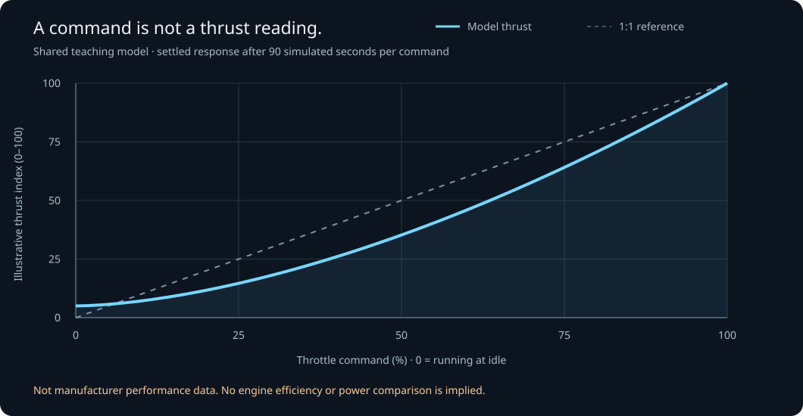

<div align="center">

# Jet Engine Playground

### An interactive field guide to turbofan engines.

An interactive turbofan learning lab built with **React · TypeScript · Vite · SVG · Web Audio**.

**[Launch the simulator](https://jet-engine-playground.vercel.app/)** &nbsp; · &nbsp; [Gallery](#inside-the-playground) &nbsp; · &nbsp; [How it works](#follow-the-air) &nbsp; · &nbsp; [Response graph](#understand-the-response) &nbsp; · &nbsp; [Quick start](#run-it-yourself) &nbsp; · &nbsp; [Technical guide](docs/GUIDE.md)

**2 engine architectures · 5 learning stages · Original visuals and synthesized audio**

No account. No API keys. No backend.

[](https://jet-engine-playground.vercel.app/)

*Click the screenshot to open the live simulator. Screenshots show the real application; readings are illustrative.*

</div>

## Inside the playground

<table>
<tr>
<td width="50%"><strong>Explore every connection</strong><br/>Select a section to isolate its role in the engine.</td>
<td width="50%"><strong>Compare the architectures</strong><br/>See sourced specifications and mechanical connections.</td>
</tr>
<tr>
<td><a href="docs/images/simulator-genx.png"></a></td>
<td><a href="docs/images/comparison.png"></a></td>
</tr>
</table>

*Select a gallery image to view it at full size. These are screenshots of the working application, not concept mockups.*

## Take the controls

Open the **[live playground](https://jet-engine-playground.vercel.app/)** and try this:

1. **Start an engine** and slowly raise the throttle. Watch the spools respond at different rates.
2. **Follow the air** from the intake through compression, combustion, turbines and exhaust.
3. **Click a component** to highlight its section and understand its job.
4. **Enable sound**, then switch engines to hear their different synthesized voices.
5. **Compare the architectures** and trace what each shaft drives.

| Explore | What changes |
| --- | --- |
| **Engine cutaway** | Metallic blade silhouettes, animated airflow and colour-matched shaft systems |
| **Operating controls** | Start, stop, throttle, pause, quarter-speed motion and reset |
| **Diagram layers** | Toggle airflow, shafts, labels and casing |
| **Temperature view** | Switch between °C and °F across section labels and the heat panel |
| **Sound** | Engine-specific airflow, rumble and spool tones that respond to operation |
| **Learning tools** | Five-step guided tour, component explanations and sourced comparisons |

> All engine sections operate continuously together. The tour is a teaching sequence, not an engine startup procedure.

## Two engines, two architectures

| | Rolls-Royce Trent XWB | GE Aerospace GEnx-1B |
| --- | --- | --- |
| **Representative variant** | Trent XWB-84 | GEnx-1B70 |
| **Aircraft** | Airbus A350-900 | Boeing 787-8 |
| **Spools** | Three: LP, IP and HP | Two: LP and HP |
| **Key connection** | The IP compressor has its own turbine and shaft | The fan and booster share the LP shaft |

## Follow the air

The fan splits the incoming flow into two paths. Only the core stream passes through combustion; the bypass stream travels around it.



This diagram describes the continuous air path, not a startup sequence. Pressure, cooling flows and exact passage geometry are simplified.

<details>
<summary><strong>Trace the shafts: what drives what?</strong></summary>

Arrows below mean **mechanical power transfer through a shaft**, not airflow. Each spool is a connected rotating assembly; it is not a single blade row.



[Read the architecture sources](SOURCES.md) · [Explore the live schematic](https://jet-engine-playground.vercel.app/)

</details>

## Understand the response

Raising the throttle changes the command. The simulated spools and thrust take time to respond, and a 50% command does not mean a thrust index of 50.

[](docs/images/throttle-response.svg)

**Generated from the actual simulation code**, sampled at 51 throttle settings after 90 simulated seconds at each setting. It shows the shared teaching model—not measured engine performance. Zero command means running at idle; the off state is separate.

<details>
<summary><strong>How the graph is produced</strong></summary>

The generator imports the same state-transition functions used by the app. It starts the engine, applies each command, advances the model, and plots the settled thrust index. The dotted line is only a visual 1:1 reference.

To regenerate with a Node version that supports TypeScript type stripping (tested with Node 26.13.1):

```sh
node scripts/readme-graph.mjs
```

The response is intentionally shared between engines. This graph cannot establish which real engine produces more thrust or uses less fuel.

</details>

## Run it yourself

Use **Node.js 22.12+** and npm:

```sh
git clone https://github.com/aaravrizzy/jet-engine-playground.git
cd jet-engine-playground
npm ci
npm run dev
```

Open the localhost URL printed in your terminal. No environment variables or keys are needed.

<details>
<summary><strong>Build, tests and security checks</strong></summary>

```sh
npm run build
npm run preview
npm test
npm run test:e2e
npm run security:scan
npm audit
```

After building, check the local production policy:

```sh
npx playwright test --config playwright.production.config.ts
```

Browser tests use Microsoft Edge. Alternative browser setup, deployment settings and command explanations are in the [technical guide](docs/GUIDE.md). Recorded checks and their limits are in [VALIDATION.md](VALIDATION.md).

</details>

<details>
<summary><strong>Project structure and adding another engine</strong></summary>

```text
src/
  data/          Engine definitions, verified facts and source links
  simulation/    State transitions, temperatures and synthesized audio
  components/    Interactive SVG cutaway and temperature panel
  App.tsx        Controls, learning, gauges and comparison
  styles.css     Responsive interface and focus states
tests/           Model, browser and production-policy tests
docs/            Screenshots and technical guide
```

Data, simulation and rendering are separate. See [Add another engine](docs/GUIDE.md#add-another-engine) for the research requirements, schema and validation steps.

</details>

<details>
<summary><strong>Keyboard, mobile and reduced motion</strong></summary>

Use **Tab** to move between controls, **Enter/Space** to activate buttons and arrow keys to adjust the throttle. The enlarged mobile cutaway scrolls sideways. Stage buttons offer an alternative to selecting the diagram.

Reduced-motion preferences stop decorative rotor and airflow motion while readings remain responsive. Sound is opt-in.

</details>

## What is real—and what is illustrative?

**Researched:** the selected aircraft applications, spool architectures, shaft connections and separately listed published specifications.

**Illustrative:** geometry, drawn blade counts, animation speeds, startup/shutdown behaviour, sound and simulated readings. Audio is synthesized, not an authentic engine recording.

The °C/°F display uses a deliberately chosen teaching scale: **20 °C ambient + 12 °C per heat-index point**. It is not manufacturer temperature data, a validated thermal model or a metal-temperature limit. Main gauges use normalized indices. Do not use the simulation to compare real-world engine performance.

| Documentation | What it covers |
| --- | --- |
| [Sources](SOURCES.md) | Engineering references and variant-specific claims |
| [Content origins](CONTENT_ORIGINS.md) | Original diagrams, code and synthesized audio |
| [Third-party notices](THIRD_PARTY_NOTICES.md) | Dependency licences and preserved notices |
| [Technical guide](docs/GUIDE.md) | Setup, controls, architecture, security and deployment |

No manufacturer artwork, logos, recordings or CAD are included. Manufacturer names identify the engines; they do not imply endorsement. No public licence for the original project code has been selected.

---

**Independent educational project.** Not affiliated with or endorsed by aircraft or engine manufacturers. Schematics and simulated readings are simplified and are not intended for flight operations, maintenance, engineering design, or certification.

[Back to top](#jet-engine-playground) · **[Open Jet Engine Playground](https://jet-engine-playground.vercel.app/)**
